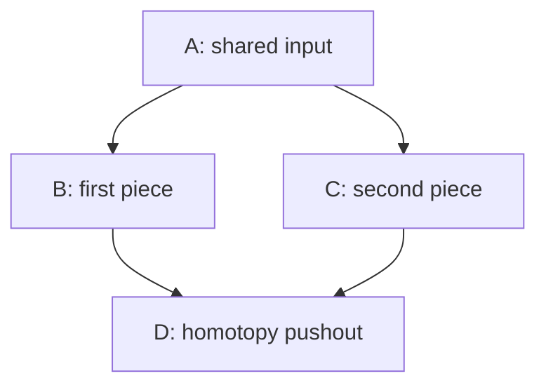

# Small visual experiments

These are **proposed experiments**, not implemented features. Their purpose is to give us mathematical objects we can inspect together and then decide what deserves a richer presentation.

## 1. Make the mixed terms visible

Start with ordinary vector spaces concentrated in degree zero. Let `first_space = ℚ²` and `second_space = ℚ³`. Define `tensor_square(space) = space ⊗ space`.

The direct sum has five basis vectors. Its tensor square has 25 basis pairs. Distinguish the two original groups of basis vectors, and arrange the 25 pairs into four blocks:

| First factor | Second factor | Number of basis pairs |
| --- | --- | ---: |
| first_space | first_space | 2 × 2 = 4 |
| first_space | second_space | 2 × 3 = 6 |
| second_space | first_space | 3 × 2 = 6 |
| second_space | second_space | 3 × 3 = 9 |

Distributivity gives the actual decomposition

$$
(\mathbb Q^2\oplus\mathbb Q^3)\otimes
(\mathbb Q^2\oplus\mathbb Q^3)
\cong
(\mathbb Q^2\otimes\mathbb Q^2)
\oplus(\mathbb Q^2\otimes\mathbb Q^3)
\oplus(\mathbb Q^3\otimes\mathbb Q^2)
\oplus(\mathbb Q^3\otimes\mathbb Q^3).
$$

The two projections of `first_space ⊕ second_space` induce a comparison from its tensor square to the two unmixed squares. Its kernel consists of the two mixed blocks. Thus the ordinary second cross-effect of this reduced functor has dimension **12**, with a direct explanation of where all twelve dimensions came from. This is an elementary derivation, not a numerical computation of an unstable homotopy group.

An interaction could hide the two unmixed blocks and leave the twelve mixed basis pairs. Exchanging the inputs exchanges the two mixed blocks. Changing the dimensions to 1 and 2 changes the count to 4. Replacing tensor square with symmetric square changes the mathematics: its mixed part has dimension 2 × 3 = **6**, because factor order is identified. Those two functors must not receive the same transformation rules merely because their pictures look similar.

This example makes the role of interaction concrete before the homotopical replacement of kernels by homotopy fibers. See the [stable smash-product example](goodwillie-calculus.md) for that next step. The original calculation above only uses finite-dimensional linear algebra.

## 2. Keep the gluing square and its comparison together

Begin with a span of spaces and its homotopy pushout:

The diagram shows the incidence of four mathematical objects and four maps. Its planar geometry is a layout choice. A Goodwillie 1-excision question asks whether applying the chosen functor makes the comparison

`F(A) → F(B) ×ʰ_{F(D)} F(C)`

an equivalence. The symbol `×ʰ` means a homotopy pullback: compatibility includes a path between the two images in `F(D)`. A displayed commuting square by itself does not certify this universal property. See the definitions and source references in [Goodwillie calculus](goodwillie-calculus.md).

A useful view would let us select an edge, inspect its map, and compare the original square with its image under a functor. Another view could show a known connectivity bound on the comparison. For a first proof-backed example, the [existing Cubical Agda Blakers–Massey source](stacks-and-formalization.md) is a concrete place to study what evidence the display would need.

## 3. Rotate a cube without changing its mathematics

A three-dimensional indexing cube has eight vertices and twelve edges. Its vertices can carry subset labels, so rotating the camera cannot change which vertex means the empty subset, which means a particular singleton, or which means the full set.

For a coherent cubical diagram, store mathematical maps and the required homotopies separately from coordinates. A face can be selected and viewed as a square; the compatibility of its two routes must be stated in the chosen model. A three-dimensional view could reveal incidence that a flat diagram hides, but the whole spaces at the vertices are not literally the vertices of a solid cube.

The indexing cube for a 2-excision test is three-dimensional. This makes camera rotation a natural display idea here. Higher indexing cubes could be inspected through faces or slices; the display does not need to pretend that it embeds the represented spaces in three dimensions.

A particularly relevant existing source is agda-unimath's [commuting cubes of maps](https://unimath.github.io/agda-unimath/foundation.commuting-cubes-of-maps.html): it contains coherence data and operations for rotations, mirrors, and pasting. Those are mathematical operations on a cube and its witnesses. A camera rotation is a separate operation on the view. The [formalization note](stacks-and-formalization.md) records the source revision and foundational assumptions.

## 4. Borrow lawful transformations from diagram research

The promising transferable idea is a diagram whose inputs, outputs, and permitted transformations have mathematical meanings. A useful experiment would carry a selected transformation together with its applicable hypotheses and source. Camera motion, rearranging a drawing, applying an equality, and supplying a homotopy should remain distinguishable actions.

The [diagram-reuse note](diagram-reuse.md) identifies existing implementations of several parts of this idea. Adapting one to these examples remains a proposal. In particular, quantum spider fusion only supplies a valid rule after choosing the appropriate algebraic interpretation; it does not automatically supply a rule for an arbitrary homotopy-functor diagram.

## Questions to keep open

- Does the tensor-block example make the cross-effect easier to see before we pass to spectra?
- Which actual functor should accompany the first gluing square: a linear example, the identity on pointed spaces, or a selected rational algebraic model?
- Is a rotatable indexing cube enough for the next conversation, or would seeing a particular map or homotopy carry more information?
- Can an existing formal proof supply a small, understandable witness that a diagram viewer can expose?

These choices concern what we want to understand. The source inventory helps us make them without requiring that we build every underlying component first.
